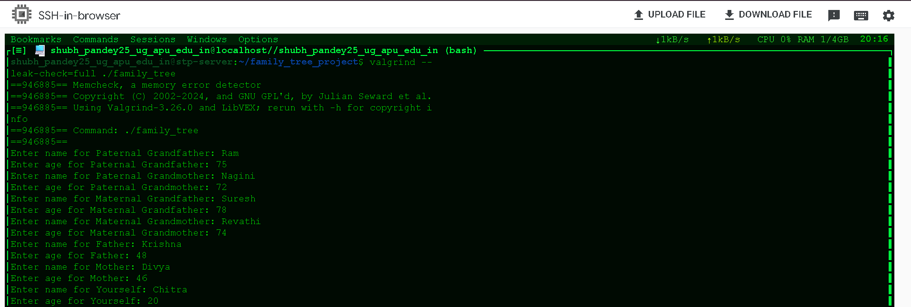
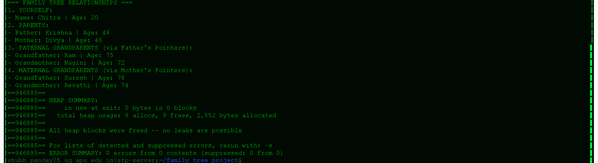

# Family Tree (C)

A C program that builds a three-generation family tree (7 people) using
pointers, prints the relationships, and frees all memory.

Compiled with `gcc -g -Wall family_tree.c -o family_tree` and checked with
`valgrind --leak-check=full ./family_tree` (0 leaks, 0 errors).

## Program execution

Input of all 7 family members:

Relationship output and valgrind result:

